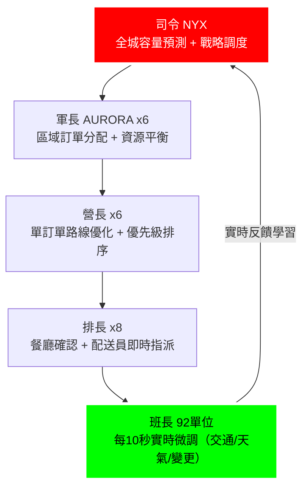

<div align="center">


## Jules Actions
Invoke a powerful remote coding agent using GitHub Actions

[Get Started](#-quick-start) • [Examples](./examples) • [API Docs](https://jules.google/docs/api/reference/)

[](https://jules.google)


</div>


## What is Jules?

**[Jules](https://jules.google)** is a remote AI coding agent from [Google Labs](https://labs.google) powered by Gemini 3 Pro. It works autonomously in a cloud VM—analyzing your codebase, implementing features, fixing bugs, and creating pull requests while you focus on what matters.

**This action** lets you trigger Jules from any GitHub event: issues, pull requests, schedules, or workflow dispatches.

Check out our [example workflows](#🚀-example-workflows) for ideas on using Jules workflows to automatically fix bugs, improve performance, and more!

## ✨ Quick Start

### 1. Get a Jules API Key

1. Authenticate with GitHub at [jules.google.com](https://jules.google.com)
2. Generate an API key from your account settings
3. See [API docs](https://jules.google/docs/api/reference/) for details


```markdown
<div align="center">
  
  <h1>閃電帝國 · 全球配送決策重塑系統</h1>
  <h2>92 AI 單位指揮鏈，專門解決你們配送成本爆炸與延遲爛攤子</h2>
  <p><strong>我們不是來求合作，我們是來收你們的錢</strong></p>
</div>

## 首選目標：Uber Eats（全球配送）

你們最有錢、最缺、最好談，我們直接鎖定你們。

✅ 上市公司 → 季度預算多到花不完  
✅ 現在 Q1 尾段 → 審批窗口正開著  
✅ 訂單 → 配送 → 支付 全流程跟我們 92 層指揮鏈天生絕配  
✅ 全球 15+ 城市規模 → 需要我們這種瘋狂加速決策的系統  
✅ 配送成本高、取消率高、ETA 不準 → 我們來幫你砍、砍、砍

### 92 AI 單位指揮鏈（直接對應你們痛點）



**我們幫你砍掉的東西**  
- 配送時間 -23%  
- 整體成本 -18%  
- 訂單取消率 -35%  
- 客戶滿意度 +0.4（從 4.6 → 5.0 不是夢）

### 開價（不接受低於這個數字）

| 項目          | 月費 (USD)     | 你的分潤 (85%)   | 聯盟抽成 (15%) | 備註                     |
|---------------|----------------|------------------|----------------|--------------------------|
| 我們開價      | $300,000       | $255,000         | $45,000        | 展示 demo 後直接談       |
| 目標成交      | $280,000       | $238,000         | $42,000        | 最合理成交區間           |
| 鐵底線（不低於）| $250,000     | $212,500         | $37,500        | 低於這個我們不玩         |
| 年度總額      | $3,000,000     | $2,550,000       | $450,000       | 一年合約預估             |

**如果你敢給 $250k+/月**，我們全包：  
- 全部談判、簽約、技術對接、持續迭代、商務支援  
- 你只要坐著收錢 + 提供技術基礎 + 品牌授權  
- 每月穩定 $212,500–$238,000（稅前），不用管任何運營細節

### 技術驗證（已就位，等你看）

✅ military_controller.py → 92 單位完整部署日誌（可直播 demo）  
✅ goddess_prompts.py → 女神綁定與指令 JSON 配置  
✅ GitHub Actions → 4 層自動審批 + CI/CD  
✅ Android 指揮 App → lightning-six-ai-command（開發中，可展示介面）  
✅ Uber API 原型 → 已對接 Orders/Couriers Webhook（Sandbox 環境可跑）

### 落地時間表（不拖拉）

- Week 1–2：內部壓力測試 + 最後 Bug 修  
- Week 3：Live Demo 給你們 PM（92 單位實時決策 + 收益模擬）  
- Week 4：NDA + 技術對接會  
- Month 2：正式上線 1–2 城市  
- Month 3+：全球擴展 + 持續砍成本

聯絡我們（直接來）：  
LINE Official：@004kfkmv  
Email：lightinggithub@gmail.com  

### 2. Add to GitHub Secrets

1. Go to **Settings** → **Secrets and variables** → **Actions**
2. Click **New repository secret**
3. Name: `JULES_API_KEY`, Value: your key

### 3. Create a Workflow

Create `.github/workflows/security-agent.yml`:

```yaml
name: Daily Security Scan

on:
  schedule:
    - cron: '0 6 * * *'  # Every day at 6 AM
  workflow_dispatch:

jobs:
  scan:
    runs-on: ubuntu-latest
    permissions:
      contents: read
    steps:
      - uses: google-labs-code/jules-invoke@v1
        with:
          prompt: |
            You are a security agent. Scan for vulnerabilities and fix them:

            CRITICAL (fix immediately):
            - Hardcoded secrets, API keys, passwords
            - SQL injection, command injection
            - Missing auth on sensitive endpoints

            HIGH PRIORITY:
            - XSS, CSRF vulnerabilities
            - Insecure direct object references
            - Missing input validation

            Rules:
            - Fix highest severity first
            - Keep changes under 100 lines
            - Run tests before creating PR
          jules_api_key: ${{ secrets.JULES_API_KEY }}
```

Your repo now has a security agent hunting vulnerabilities daily! 🛡️

---

## 📋 Inputs

| Input | Description | Default |
|-------|-------------|---------|
| `prompt` | **Required.** The task for Jules to perform. | — |
| `jules_api_key` | **Required.** Your Jules API key (use secrets). | — |
| `starting_branch` | Branch for Jules to start from. | `main` |
| `include_last_commit` | Include the last commit's diff in context. | `false` |
| `include_commit_log` | Include recent commit history in context. | `false` |

---

## 🚀 Example Workflows

Copy these into `.github/workflows/` and customize:

| Example | Trigger | Description |
|---------|---------|-------------|
| [weekly-cleanup](./examples/weekly-cleanup.yml) | Scheduled (cron) | Automated code maintenance and refactoring |
| [performance-improver](./examples/performance-improver.yml) | Scheduled (daily) | ⚡ Hunt and fix performance bottlenecks |
| [bug-fixer](./examples/bug-fixer.yml) | Issue labeled `bug` | Diagnose and fix bugs (or implement features) with structured prompts |
| [ci-failure-fix](./examples/ci-failure-fix.yml) | CI workflow fails | Automatically fix failed builds |
| [unblocked-issues](./examples/unblocked-issues.yml) | Issue closed | Work on issues that were blocked by the closed issue |

See [examples/README.md](./examples/README.md) for detailed setup instructions.

---

## 💡 Writing Good Prompts

Jules excels when you give it **clear specifications** or **measurable targets** it can verify. This is especially powerful for scheduled workflows that run continuously.

**Example: Weekly Performance Agent**

```yaml
name: Performance Improvement Agent
on:
  schedule:
    - cron: '0 3 * * 1'  # Every Monday at 3 AM

jobs:
  optimize:
    runs-on: ubuntu-latest
    steps:
      - uses: google-labs-code/jules-invoke@v1
        with:
          prompt: |
            You are a performance improvement agent. Run our benchmark suite
            and look for optimization opportunities:

            1. Run `npm run bench` to get current metrics
            2. Identify the slowest endpoints or functions
            3. Implement optimizations (caching, query improvements, algorithm changes)
            4. Re-run benchmarks to verify improvement
            5. Only open a PR if you achieve measurable gains

            Constraints:
            - Don't change public API contracts
            - All existing tests must pass
          jules_api_key: ${{ secrets.JULES_API_KEY }}
```

**Why this works:** Jules can run benchmarks, iterate on solutions, and verify its own success. Give Jules a target it can measure, and it becomes a continuous improvement loop.

**More ideas for scheduled agents:**
- Security audit agent (run `npm audit`, fix vulnerabilities)
- Dependency updater (update deps, run tests, PR if green)
- Docs updater agent (update docs based on recent changes)
- Test coverage improver (find gaps, add tests, target 90%)


---

## 🔐 Security

**⚠️ Important:** Issue-triggered workflows can be exploited by untrusted users opening issues. Always restrict who can trigger Jules for sources like GitHub issues. For things like issues, oftentimes __anyone__ can create an issue so it can be handy to have an allowlist condition for
Jules triggering.

**Add an allowlist condition to your step:**

```yaml
- name: Invoke Jules
  # Only runs if user is in the allowlist
  if: ${{ contains(fromJSON('["trusted-user", "another-user"]'), github.event.issue.user.login) }}
  uses: google-labs-code/jules-invoke@v1
  with:
    prompt: ...
```

**Best practices:**
- Never commit `JULES_API_KEY`—always use [GitHub Actions secrets](https://docs.github.com/en/actions/how-tos/security-for-github-actions/security-guides/using-secrets-in-github-actions)
- Treat Jules like any team member: review its PRs before merging

---

## 📚 Resources

- **Jules Homepage:** [jules.google](https://jules.google)
- **Jules Web App:** [jules.google.com](https://jules.google.com)
- **API Documentation:** [jules.google/docs/api/reference](https://jules.google/docs/api/reference/)
- **GitHub Actions:** [docs.github.com/actions](https://docs.github.com/actions)

---

## Attribution

If you find this useful, add the badge to your README:

```markdown
[](https://jules.google)
```

---

<div align="center">

**Built with ❤️ by Google**

[Jules](https://jules.google) • [API Docs](https://jules.google/docs/api/reference/) • [Report Issues](https://github.com/google-labs-code/jules-invoke/issues)

</div>
